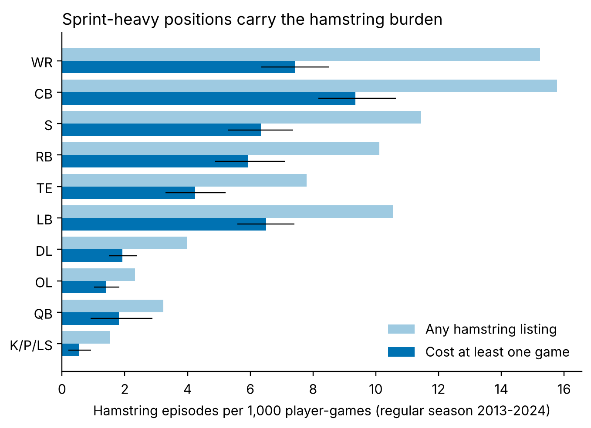
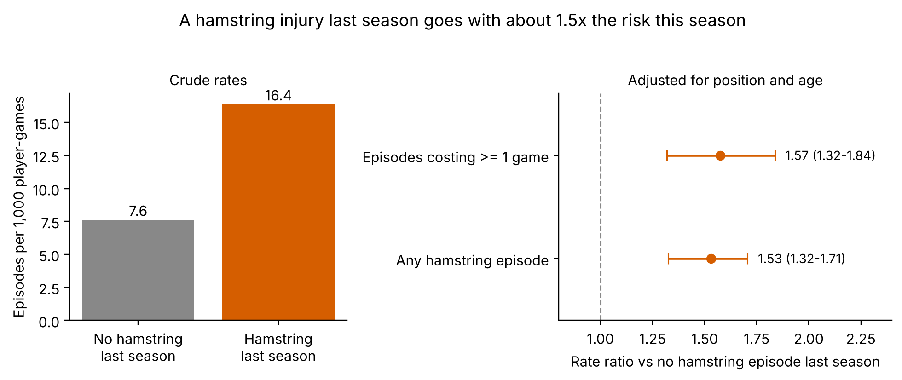
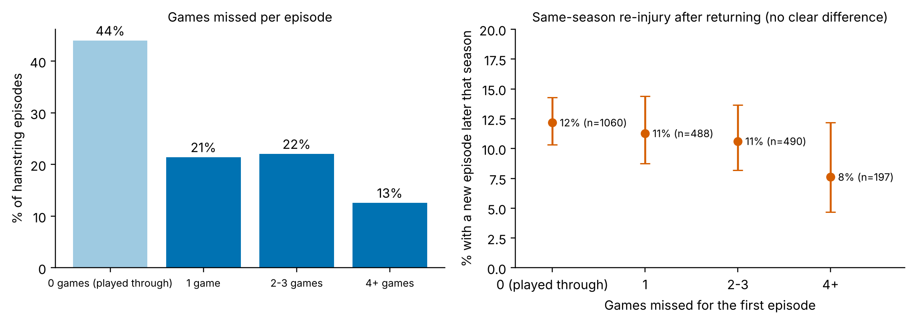
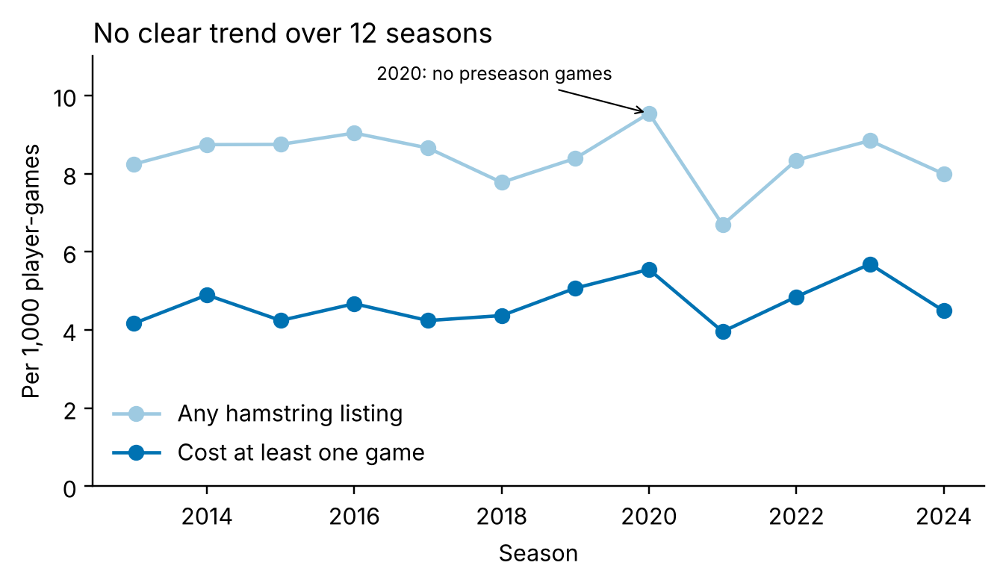

# Hamstring injuries in the NFL, 2013-2024: who gets them, what they cost, and what follows a previous one

An open, reproducible analysis of hamstring injuries in professional American football, using official weekly NFL injury reports linked to game-by-game snap counts. This gives a **true exposure denominator**, games actually played, which most public-data injury studies lack.

## Why this question
Hamstring injuries are the most common time-loss injury in sprint-based sport, and a previous hamstring injury is the strongest known risk factor for the next one. Performance staff need to know where the burden sits, how much time it costs, and how much extra risk follows an injury. All of this should be measured against real exposure.

## Data (public, via [nflverse](https://github.com/nflverse/nflverse-data); downloaded by `get_data.sh`)
- **Official weekly injury reports, 2009-2025.** Under the NFL's injury report policy, clubs must report each injured player's practice participation and game status every week. Report rows exist for 99.4-100% of team-games in every season analysed. Each row lists the player, the injury (for example "Hamstring"), practice participation and game status. There are 90,752 rows, 8,262 of which name a hamstring injury.
- **Snap counts for every player in every game, 2013-2025.** These provide exposure and show whether a player actually played.
- **Player register**, used to link IDs (99.8% of hamstring listings matched) and to get position and date of birth.
- **Analysis window:** regular seasons 2013-2024. That covers 285,073 player-games (at least one snap) by 6,682 players over 12 complete seasons.

## Methods (`nfl_hamstring.py`)
- **Hamstring episode:** weekly listings naming a hamstring injury are grouped into episodes. A listing starts a **new** episode only if the player played a game without a hamstring listing since his last one. Otherwise it continues the same episode, which covers players who sat out or went on injured reserve and were later listed again.
- **Games missed:** team games from the injury week onwards in which the player recorded no snaps, until he played again in the same season.
- **Episode types:**
  - *Any listing* (2,410 episodes) includes players who were listed but still played.
  - *Time-loss* (1,350 episodes) is the subset that cost at least one game, which is closer to medical surveillance definitions.
- **Rates:** episodes per 1,000 player-games, by position group and season.
- **Previous injury:** among players who played in two consecutive seasons, the rate this season is compared for players with and without a hamstring episode last season. The comparison is a Mantel-Haenszel rate ratio stratified by position group and age band.
- **Re-injury:** a new hamstring episode later in the same season, after the player returned.
- **Uncertainty:** 95% confidence intervals from a player-cluster bootstrap (1,000 resamples), or Wilson intervals for proportions.
- **Built-in check:** headline counts and rates were recalculated with separate code, and episodes were checked by hand against raw weekly reports and snap counts for individual players.
- **Sensitivity analyses** (`sensitivity.py`): a different episode rule, excluding the seasons with the old "Probable" status, excluding 2021, a stricter definition of previous injury, and players with at least 8 games in both seasons.

## Results

| Measure (regular season 2013-2024) | Estimate (95% CI) |
|---|---|
| Hamstring episodes per 1,000 player-games | **8.4** (8.0-8.8) |
| Episodes costing at least one game, per 1,000 player-games | **4.7** (4.4-5.0) |
| Episodes in which the player missed no game | **44%** |
| Median games missed per episode | 1 (IQR 0-2) |
| Rate ratio after a hamstring episode last season (position- and age-adjusted) | **1.53** (1.32-1.71) |
| Same, counting only episodes that cost a game | **1.57** (1.32-1.84) |
| Re-injury later in the same season, after returning | 11.2% (10.0-12.6) |
| Injured players with two or more episodes | 36% |



**1. Sprint-heavy positions carry the burden (Figure 1).** Cornerbacks (9.4 time-loss episodes per 1,000 player-games) and wide receivers (7.4) have the highest rates, followed by safeties, linebackers and running backs. Offensive linemen have 1.4 and kickers, punters and long snappers 0.5, a difference of more than five-fold.



**2. A hamstring injury last season goes with about 1.5 times the risk this season (Figure 2).** The crude rate is 16.4 vs 7.6 per 1,000 player-games. After adjusting for position and age, the rate ratio is 1.53, and it is almost the same when only injuries that cost a game are counted (1.57). This agrees in direction with the meta-analysis by Green et al. (2020), where any previous hamstring injury carried a relative risk of 2.7. The smaller ratio here is expected: this analysis looks only at the previous season rather than lifetime history, and public reports miss some injuries, which pulls ratios towards 1.



**3. Almost half of hamstring episodes are "played through" (Figure 3).** In 44% of episodes the player missed no game. Re-injury later in the same season was 12% after playing through and 8% after missing four or more games, but the confidence intervals overlap and more severe injuries differ from milder ones in many ways. **This data cannot show whether resting longer prevents re-injury.**



**4. No clear trend over 12 seasons (Figure 4).** The rate was highest in 2020, the season played without preseason games. In 2021, hamstring listings dropped by about a quarter while the total number of report rows stayed normal. The cause is unexplained (it could be real or a recording change), and excluding 2021 does not change any finding.

**5. The findings hold under other reasonable choices** (`sensitivity.csv`):

| Analysis | Episodes per 1,000 games | Adjusted rate ratio after previous-season injury (95% CI) |
|---|---|---|
| Main analysis | 8.4 | 1.53 (1.32-1.70) |
| Different episode rule (listings <= 2 weeks apart = same episode) | 8.4 | 1.60 (1.38-1.76) |
| 2016-2024 only (after "Probable" was removed) | 8.4 | 1.51 (1.27-1.69) |
| Excluding 2021 | 8.6 | 1.54 (1.34-1.76) |
| Previous injury counted only if it cost a game | 8.4 | 1.43 (1.20-1.65) |
| Players with >= 8 games in both seasons | 8.0 | 1.55 (1.34-1.77) |

**Consistency with published work:** Jenkins et al. (2024) used NFL injury reports from 2008-2020 and found that 33% of players with a hamstring injury had a later one. Here, 36% of injured players had two or more episodes in 2013-2024.

## Limitations
- **Public reports miss injuries.** Inclan et al. (2022) found that studies using public NFL data captured about two-thirds of ACL injuries recorded by team medical staff, with better capture for skill positions than for linemen. A listing on the report is a team's public disclosure, not a medical diagnosis.
- **No side, grade or imaging.** A right-leg injury after a left-leg one counts as a repeat episode.
- **Only games are measured.** Practice exposure and sprint load are not available, so the rate is per game, not per hour or per sprint.
- **Defining episodes from weekly listings needs rules.** A different rule changed only 61 of 2,410 episodes, and no conclusion changed.
- **Reporting rules changed in 2016**, when the "Probable" status was removed. Results for 2016-2024 alone are the same.
- **The results are associations.** The previous-injury comparison is adjusted only for position and age, and players who get injured may differ in other ways (speed, role, playing time).

## What this means for practice
Hamstring risk is concentrated in a few sprint-heavy roles and in players with a recent hamstring history, which is where monitoring and prevention effort should go. The open question is what staff do with an athlete who is "listed but playing". This study shows that such cases are common but cannot show whether they are handled well. Answering it needs medical-grade data with sprint exposure, such as GPS, which is exactly what a performance programme collects.

## Reproduce
```bash
pip install -r requirements.txt
./get_data.sh            # downloads nflverse files into data/
python nfl_hamstring.py  # writes results/
python make_figures.py   # writes figures/
python sensitivity.py    # writes results/sensitivity.csv
```

## Files in this repository
- Code: `get_data.sh`, `nfl_hamstring.py`, `make_figures.py`, `sensitivity.py`
- Result tables: `headline.csv`, `rate_by_position.csv`, `rate_by_season.csv`, `prior_injury_rates.csv`, `games_missed_distribution.csv`, `same_season_reinjury.csv`, `players_by_episodes.csv`, `sensitivity.csv`, `data_flow.csv`, `summary.txt`, `hamstring_episodes.csv` (one row per episode)
- Figures: `fig1_rate_by_position.png`, `fig2_previous_injury.png`, `fig3_games_missed_and_reinjury.png`, `fig4_trend.png`

Running the code writes fresh copies of the tables to `results/` and the figures to `figures/`.

## References
- Jenkins R, Bianchi J, Watson J, et al. Risk and prognosis of hamstring injuries in the National Football League: a 12-year review. *Orthop J Sports Med.* 2024;12(12). https://doi.org/10.1177/23259671241298622
- Green B, Bourne MN, van Dyk N, Pizzari T. Recalibrating the risk of hamstring strain injury (HSI): a 2020 systematic review and meta-analysis of risk factors for index and recurrent hamstring strain injury in sport. *Br J Sports Med.* 2020;54(18):1081. https://doi.org/10.1136/bjsports-2019-100983
- NFL Football Operations. 2016 NFL injury report policy. https://operations.nfl.com/updates/football-ops/2016-nfl-injury-report-policy
- Inclan PM, Chang PS, Mack CD, et al. Validity of research based on public data in sports medicine: a quantitative assessment of anterior cruciate ligament injuries in the National Football League. *Am J Sports Med.* 2022;50(6):1717-1726. https://doi.org/10.1177/03635465211015435
- nflverse data: https://github.com/nflverse/nflverse-data

## Author
Yashwanth Ajjilapuram · [ORCID 0009-0000-0198-8303](https://orcid.org/0009-0000-0198-8303)
